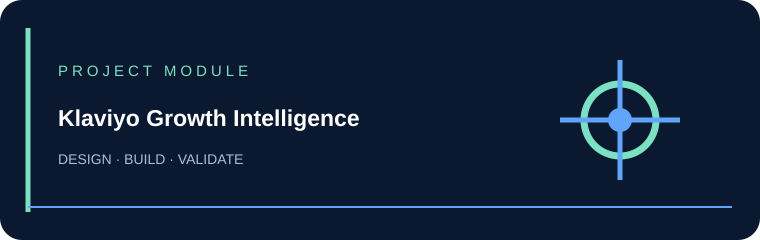

**INDEPENDENT ENGINEERING PORTFOLIO · KLAVIYO GROWTH INTELLIGENCE**

[GitHub Profile](https://github.com/sghatge) · [Portfolio](https://sghatge.github.io/adobe-campaign-v8-governance/)

---

# Klaviyo Growth Intelligence — ArtFlow AI

An interview portfolio project by Sangram Ghatge: a D2C lifecycle marketing workspace for a fictional custom portrait and artwork store.

## Interactive demo (start here)
Open the **Abandoned cart** tab and press a scenario button:
- **Recovered by email 2**: shopper ignores email 1, buys the next day. The flow credits the order to email 2.
- **Never returns**: a high-value cart sees all three emails, including the value-add branch.
- **Buys on their own**: orders within 20 minutes, before any email. Counted as organic, not recovered revenue.
- **No email consent**: the entry filter blocks every send.

You can also change the product, cart value, consent, purchase time and the value-add, scrub the timeline, open each email, and read the event log Klaviyo would record. Choose a customer on the **Customers** tab to run the journey as them. **Campaign studio** generates three subject lines and an email, runs deterministic checks, and hands off to **AI QA**, where a human approval gate stays closed until every blocking check is fixed and every manual item is ticked.

The journey rules live in `lib/journey.ts` as a pure function and are the same rules you would build in Klaviyo: trigger on Started Checkout, consent filter, 1h / 24h / 48h waits, exit condition on Placed Order, and a split on cart value.

## What it demonstrates
- Klaviyo-style lifecycle flows: welcome, abandoned cart, browse abandonment, post-purchase, win-back and review request.
- AI-assisted campaign copy generation through Vercel AI Gateway, with a clearly labelled demo fallback.
- Customer segmentation and read-only Klaviyo profile integration.
- Campaign QA checklist with mandatory human approval.
- Supabase-backed synthetic demo customer, flow and campaign data protected by RLS.
- Read-only Klaviyo API endpoints for account status, profiles and flows.

## Stack
Next.js App Router, TypeScript, Vercel, Supabase Postgres, Klaviyo REST API and optional Vercel AI Gateway.

## Run locally
1. Install Node.js 20.9+.
2. Copy .env.example to .env.local and set the Supabase URL and publishable key.
3. Add a restricted Klaviyo private API key only when you have your own test account.
4. Run npm install, then npm run dev.

## Live vs demo data
Every screen labels its source. With no Klaviyo key the app shows Supabase seed rows (or built-in demo rows if the database is unreachable). With a key it reads accounts, flows, campaigns, profiles and 30-day Placed Order revenue from Klaviyo, and falls back section by section with a visible warning if any call fails.

## Environment variables
- NEXT_PUBLIC_SUPABASE_URL
- NEXT_PUBLIC_SUPABASE_PUBLISHABLE_KEY
- KLAVIYO_PRIVATE_API_KEY (server-side only; read-only scopes recommended)
- KLAVIYO_API_REVISION
- KLAVIYO_ALLOW_EVENT_WRITES (optional, default false; lets the demo send one Started Checkout test event, needs events:write)
- KLAVIYO_TEST_EMAIL_DOMAINS (default example.test; events are only ever sent to these domains)
- AI_GATEWAY_API_KEY (optional; server-side only)
- AI_GATEWAY_MODEL (optional)

## Safety and demo integrity
All sample customer records and revenue figures are synthetic. The application does not send campaigns or activate flows. The only possible Klaviyo write is the optional Started Checkout test event, which is off by default and limited to allowlisted test email domains. Use a dedicated Klaviyo test account and a custom private key with only the scopes you need (read scopes, plus events:write only if you enable test events). Never expose private keys through NEXT_PUBLIC variables or commit secrets.

## Supabase
The project database has tables for customer_profiles, campaign_briefs, lifecycle_flows, qa_runs and campaign_metrics. Synthetic demo rows are readable under RLS; anonymous writes are not granted.

## Portfolio walkthrough
1. Explain the lifecycle flows and triggers.
2. Generate campaign content for a selected segment.
3. Review customer profile and behavioral properties.
4. Run the pre-send QA checklist.
5. Demonstrate the read-only Klaviyo connection and Supabase integration.

This project demonstrates practical Klaviyo learning and transferable CRM/marketing automation skills; it is not a claim of prior years of professional Klaviyo platform experience.

---

## Portfolio, reproducibility & safe use

- [Sangram Ghatge — complete engineering portfolio](https://github.com/sghatge/sghatge)
- [OPSFORGE Build Lab](https://sghatge.streamlit.app/) — portfolio index only; this project is documented and maintained in its own repository.

**Reproducibility:** start with the setup and usage instructions in this README and the linked project documentation. Run the repository's available checks before changing behaviour; if no test command is documented, treat that as a validation task rather than assuming tests pass.

**Safe-use boundary:** this is an independent portfolio project. Use synthetic or sanitized examples. Do not treat sample configurations, assessments, checklists or simulated outputs as production approvals or connect the project to customer data or live enterprise systems without independent security, privacy, legal and operational review. Review dependencies, licences and secrets handling before deployment.
